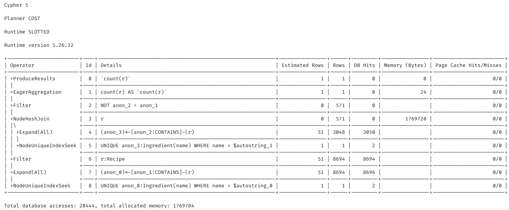
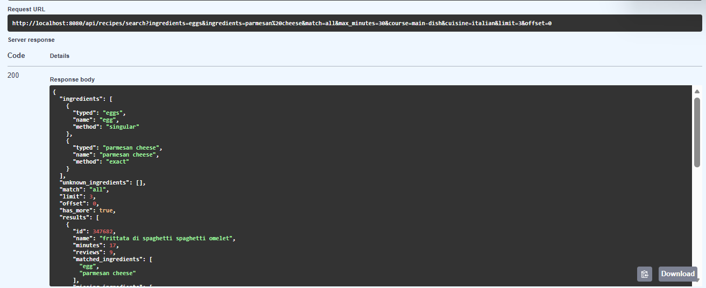

# Recipe & Ingredient Explorer

A graph-backed API to explore recipes and ingredients, built with **Neo4j 5 + Graph Data Science**, **FastAPI**, **Nginx** and **Docker Compose** (Python 3.11).

> Status: recipe search, recipe details, ingredient suggestions and the natural-language agent (NL-to-Cypher with guardrails) work. Graph algorithms (GDS) are in progress.

## Architecture

```
Browser ──▶ Nginx (localhost:8080) ──▶ FastAPI (api:8000) ──▶ Neo4j + GDS (neo4j:7687)
```

Only Nginx is exposed to the outside. Neo4j's ports (7474 for the browser, 7687 for Bolt) are also exposed for development.

## Prerequisites

- Python 3.11
- Docker Desktop
- GNU make. On Windows: `winget install ezwinports.make`

## Setup

1. Clone the repository.
2. Create your settings file and fill in your own values:
   ```
   cp .env.example .env
   ```
   `NEO4J_PASSWORD` must be at least 8 characters (letters, digits and dashes only). Keep `NEO4J_USER=neo4j`.
3. Download the [Food.com dataset](https://www.kaggle.com/datasets/shuyangli94/food-com-recipes-and-user-interactions) and put `RAW_recipes.csv` and `RAW_interactions.csv` in `data/raw/`.
4. Install the development environment:
   ```
   make install
   ```
5. Clean the raw data (writes `data/processed/`):
   ```
   make prepare-data
   ```
6. Start the stack (see below), then load the data into Neo4j (about 3 minutes):
   ```
   make seed
   ```

## Run with Docker

```
make docker-run      # start Neo4j, the API and Nginx
make docker-down     # stop everything (data is kept)
```

- API health: http://localhost:8080/health → `{"status":"ok","neo4j":"up"}`
- API docs: http://localhost:8080/docs
- Neo4j Browser: http://localhost:7474 (user `neo4j`, password from `.env`)

## API examples

All endpoints are documented and can be tried in Swagger: http://localhost:8080/docs

### Search recipes by ingredients

`GET /api/recipes/search`

```
curl "http://localhost:8080/api/recipes/search?ingredients=eggs,parmesan&course=main%20dish&cuisine=italian&max_minutes=30&limit=3"
```

```json
{
  "ingredients": [
    {"typed": "eggs", "name": "egg", "method": "singular"},
    {"typed": "parmesan", "name": "parmesan cheese", "method": "closest"}
  ],
  "unknown_ingredients": [],
  "match": "all",
  "limit": 3,
  "offset": 0,
  "has_more": true,
  "results": [
    {
      "id": 347682,
      "name": "frittata di spaghetti spaghetti omelet",
      "minutes": 17,
      "reviews": 9,
      "matched_ingredients": ["egg", "parmesan cheese"],
      "missing_ingredients": ["ground black pepper", "spaghetti", "butter", "salt"]
    }
  ]
}
```

- `ingredients`: one per parameter or separated by commas (at most 10)
- `match`: `all` (every ingredient, default) or `any` (at least one)
- `max_minutes`, `diet`, `course`, `cuisine`: optional filters. A cuisine includes its sub-cuisines (`asian` also finds chinese and szechuan recipes)
- `limit` / `offset`: pagination (`offset=20` with `limit=20` is page 2), `has_more` says if there is a next page
- `method` shows how each typed ingredient was understood: `exact`, `singular` or `closest` (a full-text guess)

### Recipe details

`GET /api/recipes/{id}`

```
curl "http://localhost:8080/api/recipes/347682"
```

Returns the steps, ingredients, cuisines, diets, courses, nutrition, number of reviews and average rating.

### Ingredient suggestions

`GET /api/ingredients?q=...`

```
curl "http://localhost:8080/api/ingredients?q=parmesan&limit=3"
```

```json
[
  {"name": "parmesan cheese", "recipe_count": 3048},
  {"name": "low-fat parmesan cheese", "recipe_count": 10},
  {"name": "fat-free parmesan cheese", "recipe_count": 8}
]
```

### Ask a question in plain English (AI agent)

`POST /api/ask`

```
curl -X POST "http://localhost:8080/api/ask" -H "Content-Type: application/json" -d "{\"question\": \"Which cuisine has the most vegan recipes?\"}"
```

```json
{
  "question": "Which cuisine has the most vegan recipes?",
  "status": "answered",
  "cypher": "MATCH (r:Recipe)-[:FITS_DIET]->(:Diet {name: 'vegan'}), (r)-[:HAS_CUISINE]->(c:Cuisine) RETURN c.name AS cuisine, count(r) AS recipe_count ORDER BY recipe_count DESC LIMIT 1",
  "results": [{"cuisine": "north-american", "recipe_count": 482}],
  "summary": "...",
  "llm_confidence": 1.0,
  "checks": [{"name": "read-only", "passed": true, "detail": "ok"}, "..."],
  "attempts": 1,
  "trace": [
    {"step": "generate #1", "detail": "query written (self-reported confidence 1.00)"},
    {"step": "validate", "detail": "all checks passed"},
    {"step": "execute", "detail": "1 rows returned by Neo4j"}
  ],
  "cached": false
}
```

Gemini writes a Cypher query, the guardrails check it (read-only, schema, LIMIT, Neo4j EXPLAIN), it runs in a read-only transaction, and the answer keeps the verified rows (`results`) apart from the AI-generated text (`summary`). Add `"summarize": false` to skip the summary and use half the Gemini quota. Details, guardrails and limits: [docs/agent.md](docs/agent.md).

### Check a query with the guardrails

`POST /api/ask/check` runs the same guardrails on any query, without running it and without the LLM:

```
curl -X POST "http://localhost:8080/api/ask/check" -H "Content-Type: application/json" -d "{\"cypher\": \"MATCH (n) DETACH DELETE n\"}"
```

```json
{
  "passed": false,
  "checks": [
    {"name": "read-only", "passed": false, "detail": "write clauses are not allowed: DELETE, DETACH"},
    {"name": "returns data", "passed": false, "detail": "the query must end with RETURN"},
    "..."
  ]
}
```

### Errors

| Code | When |
|---|---|
| 404 | no typed ingredient matches anything, or unknown recipe id |
| 422 | invalid parameter (for example `limit=500`), more than 10 ingredients, unknown diet / course / cuisine |
| 503 | the graph database is unreachable, or (for `/api/ask`) no Gemini key or Gemini unavailable |

## Screenshots

Recipes containing basil in the Neo4j Browser:


PROFILE of a two-ingredient search: Neo4j starts from the indexed ingredient nodes (NodeUniqueIndexSeek) instead of scanning every recipe, which costs about 20k db hits instead of 1.1M (see docs/benchmarks.md):



Recipe search in Swagger:




## Development

```
make help      # list all commands
make run       # run the API locally on http://127.0.0.1:8000
make prepare-data  # clean the raw CSVs into data/processed
make seed      # load data/processed into Neo4j (Neo4j must be running)
make benchmark # compare queries with and without their index (see docs/benchmarks.md)
make evaluate-agent  # ask the AI agent 13 test questions, writes docs/agent_evaluation.md
make test      # run the tests with coverage
make lint      # pylint
make format    # black
```

## Project structure

```
app/
├── main.py               # FastAPI app, startup/shutdown, error handlers
├── agent/                # NL-to-Cypher agent (LangGraph + Gemini)
│   ├── graph.py          # the workflow: generate, validate, execute, summarize
│   ├── guardrails.py     # checks on every LLM-written query
│   ├── prompts.py        # prompts sent to Gemini
│   └── schema.py         # graph schema used by the prompt and the guardrails
├── config.py             # settings read from .env
├── dependencies.py       # shared FastAPI dependencies
├── ingredient_names.py   # name rules shared by the API and the cleaning script
├── database/
│   └── neo4j_client.py   # Neo4j driver wrapper (read, write, profile)
├── models/               # Pydantic models (inputs and outputs)
│   ├── recipes.py
│   └── agent.py
├── routers/              # HTTP layer: parameters, status codes
│   ├── health.py         # GET /health
│   ├── recipes.py        # GET /api/recipes/search, GET /api/recipes/{id}
│   ├── ingredients.py    # GET /api/ingredients
│   └── agent.py          # POST /api/ask, POST /api/ask/check
└── services/
    └── recipes.py        # Cypher queries
docs/                     # graph model, benchmarks, diagrams, screenshots
nginx/nginx.conf          # reverse proxy configuration
notebooks/                # data exploration
scripts/                  # clean_data.py, seed_data.py, benchmark.py, evaluate_agent.py
tests/                    # unit, API and Cypher tests
```
